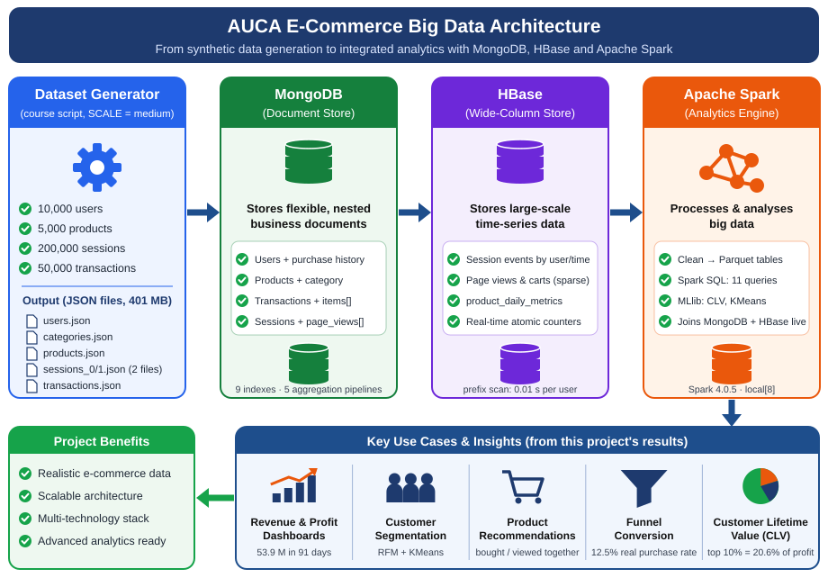

# AUCA Big Data Analytics – Final Project
**Distributed Multi-Model Analytics for E-commerce Data** · MongoDB · HBase · Apache Spark · Jupyter Lab

**Author:** Christian MANZI SHEMA · Student ID 101382 · AUCA, November 2026

📄 **Technical report (8 pages):** [`docs/Technical_Report_Christian_MANZI_SHEMA_101382.pdf`](docs/Technical_Report_Christian_MANZI_SHEMA_101382.pdf)



### Headline results (medium scale: 200,000 sessions, 50,000 orders)
| Result | Value |
|---|---|
| MongoDB index vs collection scan (one customer's orders) | 4 docs in 3 ms vs 50,000 docs in 27 ms |
| HBase key lookup vs full-table scan | ~333× cheaper (14.5 ms per user) |
| Parquet vs NDJSON (Spark) | 3.6× faster |
| Real purchase rate vs platform "converted" flag | 12.5% vs 20.3% (flag over-reports by 62%) |
| Biggest funnel leak | cart → checkout (72,134 sessions lost) |
| Top 10% of customers' share of projected 12-month profit | 20.6% |


Everything runs on your own computer, in 7 notebooks, in order.

## 1. What you need (one-time setup)

| Tool | Version | Why | Check |
|---|---|---|---|
| Python | 3.10–3.13 (tested on 3.13) | notebooks | `python --version` |
| Java (JDK) | **17** | Spark | `java -version` |
| Docker Desktop | recent | MongoDB + HBase | `docker --version` |
| RAM | 8 GB minimum (16 GB comfortable) | Spark + Docker | |

**Windows:** native Windows works: `src/config.py` points Spark at the bundled `tools/hadoop/bin/winutils.exe` + `hadoop.dll` and ignores any system-wide `SPARK_HOME` / `HADOOP_CONF_DIR`. Run the generator with `python -u` (see notebook 00).
**Apple-silicon Mac:** the HBase image is amd64 and runs under emulation (works, a bit slower).

```bash
# from the project folder
python -m venv .venv
source .venv/bin/activate            # Windows PowerShell: .venv\Scripts\Activate.ps1
pip install -r requirements.txt
python -m ipykernel install --user --name ecom --display-name "Python (ecom)"

docker compose up -d                 # starts MongoDB (27017) and HBase (Thrift 9090)
docker compose ps                    # wait ~60 s for HBase; web UI: http://localhost:16010

jupyter lab                          # then open notebooks/ and choose the "Python (ecom)" kernel
```

## 2. Run order

| # | Notebook | Needs Docker? | Assignment part | Approx. time (medium) |
|---|---|---|---|---|
| 00 | `00_environment_and_data_generation` | no | Dataset | 2–4 min |
| 01 | `01_mongodb_modeling_and_queries` | **Mongo** | Part 1.1 (25 %, shared) | 5–10 min |
| 02 | `02_hbase_modeling_and_queries` | **HBase** | Part 1.2 | 10–20 min (load) |
| 03 | `03_spark_batch_processing` | no | Part 2.1 (30 %, shared) | 5–10 min |
| 04 | `04_spark_sql_analytics` | optional | Part 2.2 | 2–5 min |
| 05 | `05_integrated_analytics` | optional | Part 3 (25 %) | 5–10 min |
| 06 | `06_visualization_and_insights` | no | Part 4 (20 %) | 1 min |

Notebooks 04 and 05 use **live** MongoDB/HBase if they are running and otherwise fall back to the same data from Parquet, and **print which one they used**. For the best mark run them with Docker up, so the integration is real.

**Dry run first:** in notebook 00 set `SCALE="small"` (≈10 s); when everything works, switch to `"medium"` (recommended), delete `data/`, and run again.
(`full` = the 2 M sessions of the assignment text needs 15+ GB RAM just to *generate*; say so in the scalability section instead.)

## 3. Where is each assignment deliverable?

| Requirement | Where |
|---|---|
| MongoDB schema + justification | notebook 01 (top + Step 2), `src/mongo_transform.py` |
| ≥ 2 aggregation pipelines | notebook 01, Step 6 (5 pipelines) |
| HBase schema + justification | notebook 02 (Step 1), `src/hbase_schema.py` |
| HBase load + per-user session query | notebook 02, Steps 5 and 7 |
| HBase shell commands | `hbase/hbase_shell_commands.txt` |
| Spark cleaning + recommendations + cohort | notebook 03 |
| Spark SQL + "MongoDB/HBase" SQL | notebook 04 (`outputs/spark_sql_queries.sql`) |
| Integrated query (CLV + funnel) | notebook 05 |
| 3–4+ visualizations | notebook 06 → `outputs/figures/` (8 charts) |
| Technical report (6–8 pages) | start from `docs/REPORT_TEMPLATE.md` |
| Tests | `pytest -q` |

## 4. Troubleshooting

| Symptom | Fix |
|---|---|
| `Py4JNetworkError` / "Answer from Java side is empty" | Spark ran out of memory → `export SPARK_DRIVER_MEMORY=2g` (or `3g`) before `jupyter lab`, or use `SCALE="small"` |
| `JAVA_HOME is not set` / `java: command not found` | install JDK 17 and restart the terminal |
| MongoDB "not reachable" | `docker compose up -d mongo`; check `docker ps`; port 27017 free? |
| HBase connection refused / timeout | HBase needs ~60 s to start; `docker logs ecom-hbase`; the Thrift port is 9090 |
| HBase load very slow | lower `MAX_SESSIONS` (50 000 is enough as a "significant representative subset") |
| Spark SQL says `PYTHON_VERSION_MISMATCH` | start Jupyter from the activated venv (`config.py` pins `PYSPARK_PYTHON` to the notebook's Python) |
| Dates look odd (2026, not 2025) | the generator uses *today* as "now"; the sample JSON in the PDF is just an example |

## 5. Publishing to GitHub
```bash
git init && git add . && git commit -m "AUCA Big Data final project"
git branch -M main && git remote add origin <your-repo-url> && git push -u origin main
```
`data/` is git-ignored (large and reproducible: it is regenerated with a fixed seed except for the date offsets). Before committing, run **Kernel → Restart & Run All** on each notebook so outputs are saved, or clear them for a smaller repo.

## 6. Folder layout
```
notebooks/   7 Jupyter notebooks (run in order)          src/      config + tested helper modules + dataset generator
data/raw/    generated JSON                              tests/    pytest unit tests (row keys, round-trips, transforms)
data/processed/  NDJSON + Parquet (Spark output)         hbase/    HBase shell commands
outputs/tables/  CSV results      outputs/figures/ PNGs  docs/     report template
docker-compose.yml   MongoDB + HBase
```
